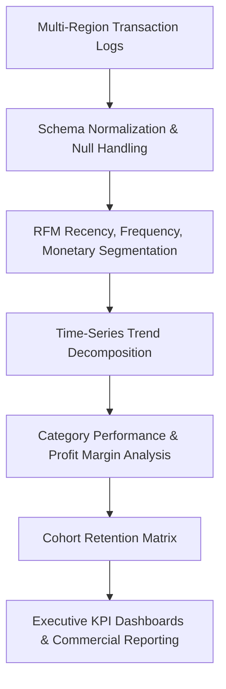

# Sales Datasets Analysis

## Overview
The Sales Datasets Analysis platform delivers multi-region commercial analytics, customer purchasing behavior modeling, and revenue performance metrics. It equips commercial decision-makers with empirical insights into product performance, regional demand trends, and seasonal revenue cycles.

## System Architecture



## Core Features
- **Commercial Performance Tracking**: Granular revenue, order volume, and average order value (AOV) metrics.
- **RFM Customer Segmentation**: Quantitative cohort partitioning based on Recency, Frequency, and Monetary valuation.
- **Product Lifecycle Analytics**: SKU velocity analysis and category-level contribution margin attribution.
- **Forecasting Preparation**: Data pipeline preparing normalized transaction vectors for predictive time-series models.

## Repository Structure
```
sales-datasets-analysis/
|-- notebooks/
|-- data/
|-- requirements.txt
+-- README.md
```

## Technology Stack
| Domain | Tooling |
| :--- | :--- |
| Environment | Python 3.10+ |
| Data Manipulation | Pandas, NumPy |
| Visual Analytics | Matplotlib, Seaborn |
| Reporting | Jupyter Notebooks |

## Installation & Execution
```bash
git clone https://github.com/sohailahmed-bsrh/sales-datasets-analysis.git
cd sales-datasets-analysis
pip install -r requirements.txt
```

## License
Distributed under the MIT License.
