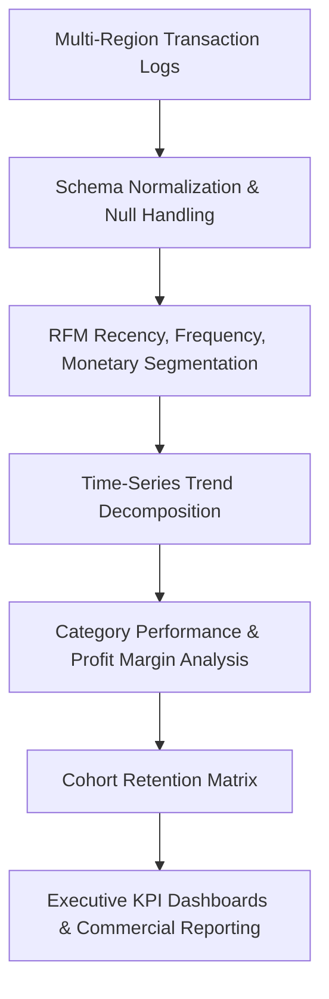

# Sales Datasets Analysis

## Overview
The Sales Datasets Analysis platform delivers multi-region commercial analytics, customer purchasing behavior modeling, and revenue performance metrics. It equips commercial decision-makers with empirical insights into product performance, regional demand trends, and seasonal revenue cycles.

## System Architecture



## Core Features
- **Commercial Performance Tracking**: Granular revenue, order volume, and average order value (AOV) metrics.
- **RFM Customer Segmentation**: Quantitative cohort partitioning based on Recency, Frequency, and Monetary valuation.
- **Product Lifecycle Analytics**: SKU velocity analysis and category-level contribution margin attribution.
- **Forecasting Preparation**: Data pipeline preparing normalized transaction vectors for predictive time-series models.

## Repository Structure
```
sales-datasets-analysis/
|-- notebooks/
|-- data/
|-- requirements.txt
+-- README.md
```

## Technology Stack
| Domain | Tooling |
| :--- | :--- |
| Environment | Python 3.10+ |
| Data Manipulation | Pandas, NumPy |
| Visual Analytics | Matplotlib, Seaborn |
| Reporting | Jupyter Notebooks |

## Installation & Execution
```bash
git clone https://github.com/sohailahmed-bsrh/sales-datasets-analysis.git
cd sales-datasets-analysis
pip install -r requirements.txt
```

---

## Author & Contact Information

<table width="100%" align="center">
  <tr>
    <td align="center" style="padding: 20px;">
      <h3>Sohail Ahmed</h3>
      <p><strong>Full-Stack Artificial Intelligence & Computer Vision Engineer</strong></p>
      <p>
        <a href="https://sohail.devsil.com"></a>
        <a href="https://github.com/sohailahmed-bsrh"></a>
        <a href="https://linkedin.com/in/sohail-ahmed-dev"></a>
        <a href="mailto:sohail.bsrh@gmail.com"></a>
      </p>
      <p><em>Available for technical roles in Artificial Intelligence, Computer Vision, and Full-Stack Engineering.</em></p>
      <hr style="border: 0; height: 1px; background: #30363d; margin: 15px 0;">
      <small>Distributed under the MIT License.</small>
    </td>
  </tr>
</table>
